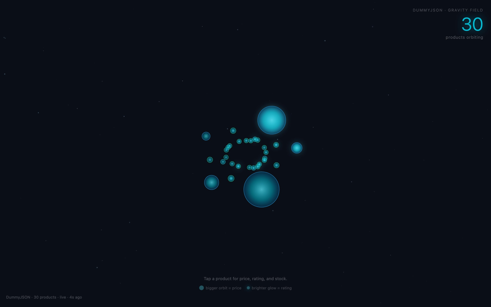
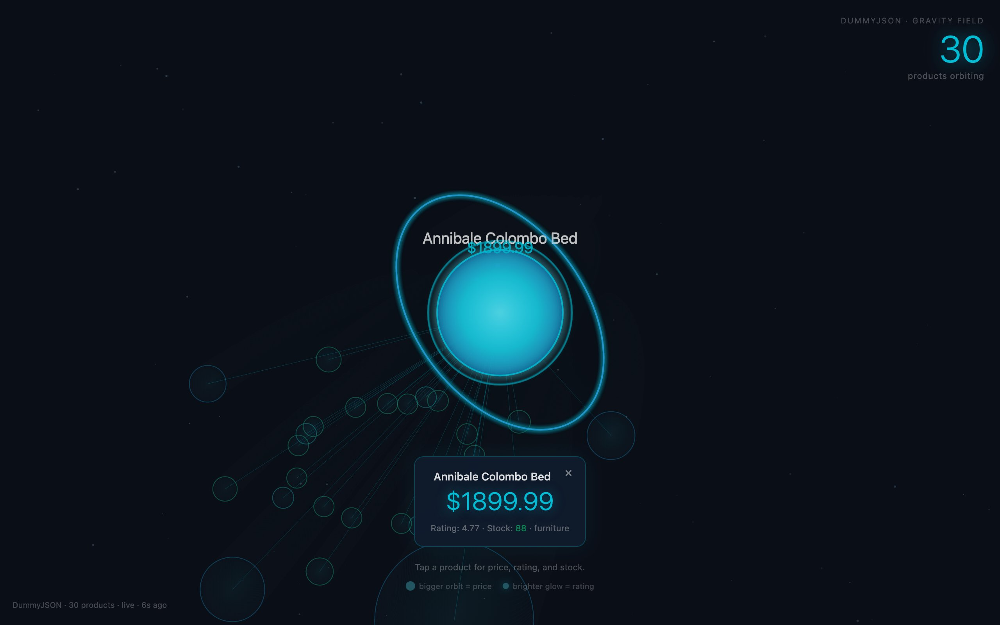

<div align="center">

<h1>orbit</h1>

<p><b>A store catalogue as a gravity field.</b></p>

<p><i>Thirty products from the DummyJSON catalogue pull on each other, and the expensive ones pull hardest.</i></p>

<h6>


</h6>

<a href="https://orbit.parthchandak.info"><b>Live demo</b></a> ·
<a href="#how-it-works"><b>How it works</b></a> ·
<a href="#focus-a-product"><b>Focus a product</b></a> ·
<a href="#run-it"><b>Run it</b></a>

<br><br>

<a href="https://orbit.parthchandak.info"></a>

<sub>Live capture, 22 October 2026. Product data from DummyJSON, a public mock-store API.</sub>

</div>

<br>

Each sphere is a product from the [DummyJSON](https://dummyjson.com/docs/products) products
endpoint, a free mock-store API. Every product attracts every other one with Newtonian gravity
(an O(n²) n-body step each frame), so the catalogue drifts into a slowly churning cluster
where the heaviest, priciest items sit like planets among the cheap ones. It is a single HTML
file with no libraries.

## How it works

| Product field | Drives |
|---|---|
| `price` | Mass and sphere size, plus the size of the orbit ellipse drawn on focus (log scale) |
| `rating` | Glow strength and brightness; only the eight best-rated products get a glow |
| `stock` | Number of particles circling the product on hover or focus (3 to 15) |
| `category` | Hue of the sphere's outline and its orbit ring |

The page draws a built-in set of 15 fallback products at once, then swaps in the live
catalogue when the request returns. The stamp in the bottom-left reads `live` or `fallback`
with the seconds since the fetch. With `prefers-reduced-motion` the simulation holds still.

## Focus a product

<div align="center">



<sub>After clicking the largest sphere. Live DummyJSON data.</sub>

</div>

Click or tap a sphere and the camera zooms in 2.2x, the rest of the field dims, faint lines
show its pull on every other product, and a panel gives the title, price, rating, stock and
category. Hover shows the name and price without zooming. Click empty space to zoom back out.

## Run it

```bash
git clone https://github.com/parthchandak02/orbit.git
cd orbit
python3 -m http.server 8000   # then open http://localhost:8000
```

The live version is the same file on Cloudflare Pages.

<details>
<summary><b>Project layout</b></summary>

```
index.html   Everything: config object C, n-body physics, camera, drawing, fetch, panel
brief.md     The original creative brief: concept, palette and data-to-visual encoding
.nojekyll    Serves the folder as-is on static hosts
```

Gravity constant, damping, size ranges, zoom and timings all live in the `C` object at the
top of the script.

</details>

<br>

<div align="center">
<sub>Built with the Canvas 2D API and plain JavaScript. Data from DummyJSON.</sub>
</div>
